# atlas-learn

**Any topic → your own interactive handbook. One command.**

Tell Claude what you want to learn. It asks a few questions, reads real sources, and builds you a mini-website: chapters, diagrams, quizzes, flashcards - and every fact linked to its source. If something can't be verified, it's marked as missing. Never invented.

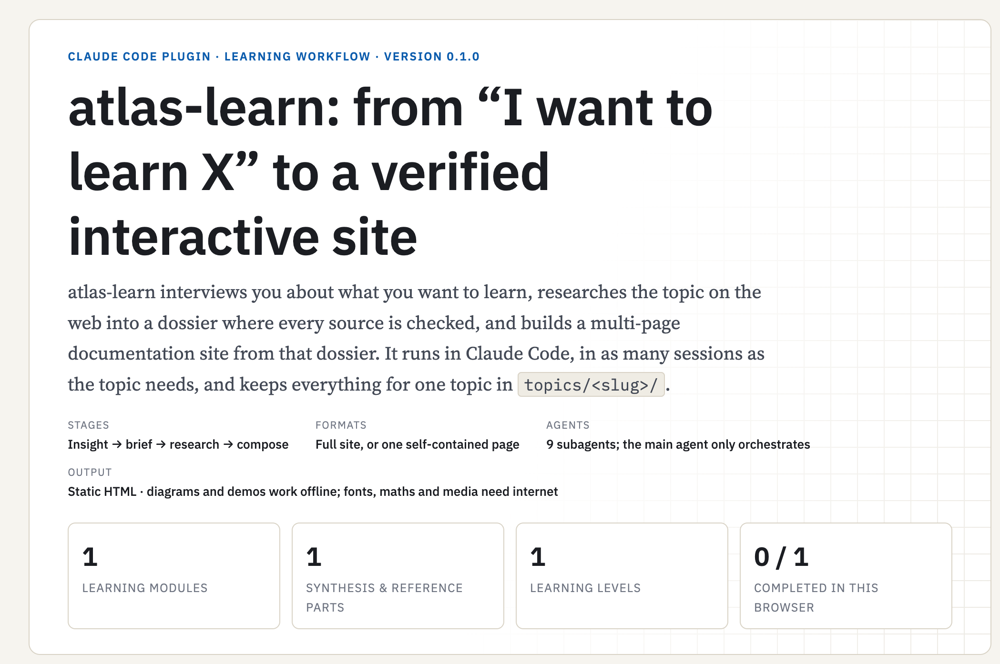

## Install

```bash
git clone https://github.com/voxvanhieu/atlas-learn && cd atlas-learn
# macOS / Linux
./install.sh
# Windows
powershell -ExecutionPolicy Bypass -File .\install.ps1
```

No accounts. No keys. Works in every Claude Code session on your machine.

## Learn something

```
/atlas-learn:go how do quadcopters fly?
```

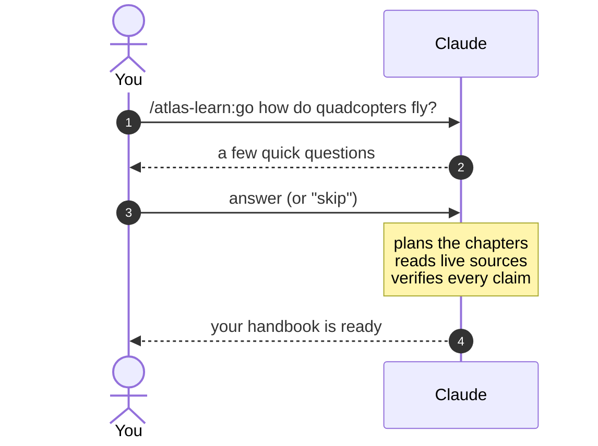

Come back anytime - `/atlas-learn:go` continues exactly where it stopped.

## The journey

What you end up with: a **topics dictionary** to pick a topic from...

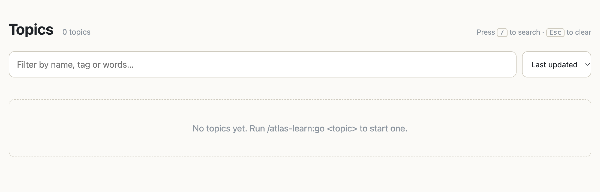

...and the handbook itself:

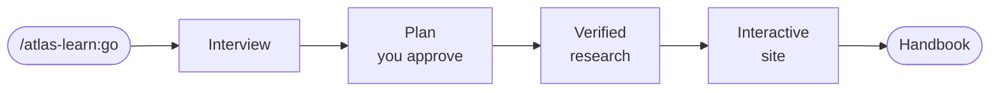

| Why it's good            |                                                             |
| ------------------------ | ----------------------------------------------------------- |
| **Facts with receipts**  | every claim cites its source - gaps are shown, never hidden |
| **Actually interactive** | quizzes, flashcards, click-through diagrams                 |
| **Life happens**         | stop anytime, resume anytime                                |
| **Your size**            | one page for quick topics, a full site for big ones         |

Click-through diagrams - switch the layers of a drawing on and off:

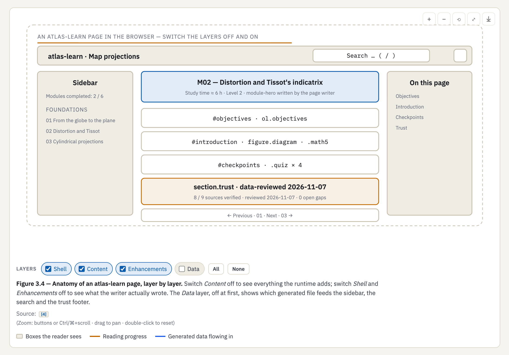

Quizzes with answers you think through before revealing:

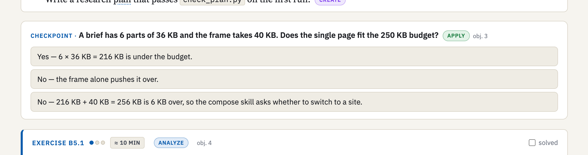

Publication-quality plots, computed live in the page:

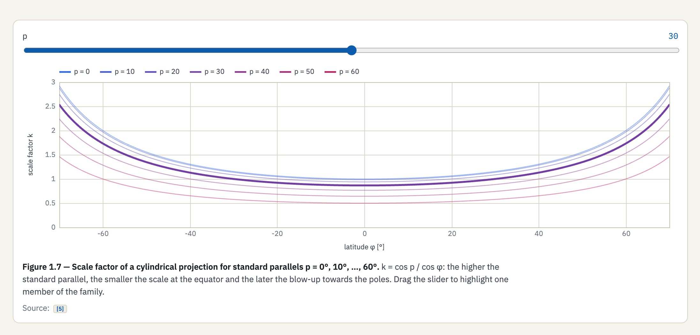

## A look inside

Circuits drawn from data, down to the junction dots:

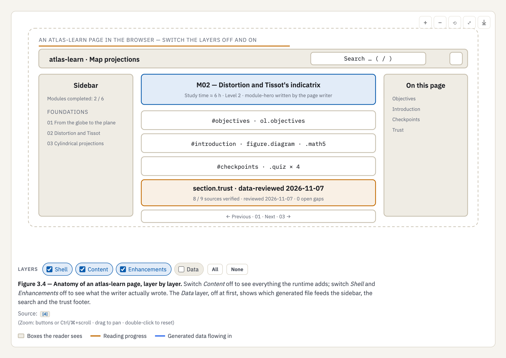

Protocol exchanges as sequence diagrams:

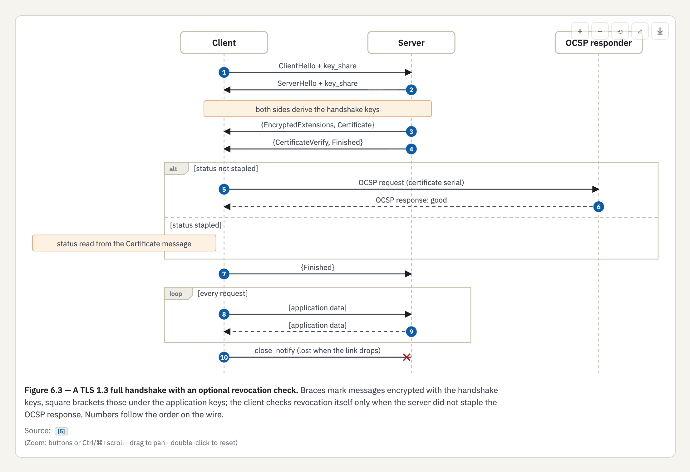

Simulations with uncertainty you can re-run:

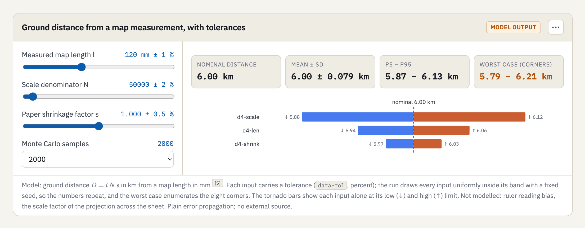

Flashcards generated from the glossary:

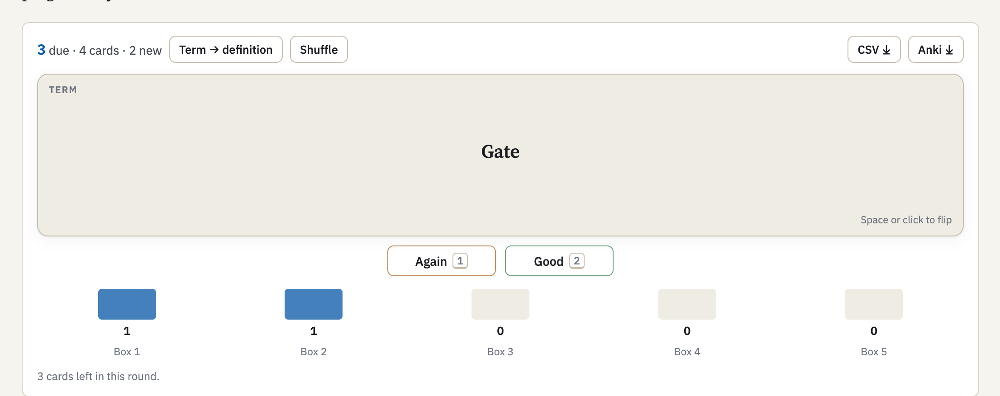

And a live Python sandbox on the page:

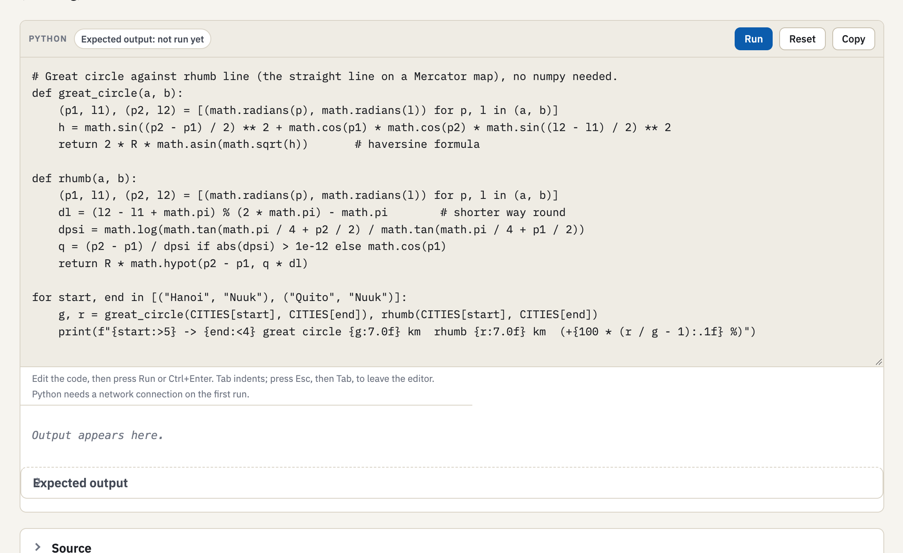

## Commands

| Command                                                                            | Does                      |
| ---------------------------------------------------------------------------------- | ------------------------- |
| `/atlas-learn:go <topic>`                                                          | the whole journey         |
| `/atlas-learn:go <topic> --single`                                                 | the one-page version      |
| `/atlas-learn:collect-insights` · `/atlas-learn:research` · `/atlas-learn:compose` | run the stages one by one |

## Update · Remove

```bash
# update
claude plugin marketplace update voxvanhieu
claude plugin update atlas-learn@voxvanhieu
# remove
claude plugin uninstall atlas-learn@voxvanhieu
claude plugin marketplace remove voxvanhieu
```

---

The full component catalog with screenshots: [docs/SUPPORTED_FEATURES.md](docs/SUPPORTED_FEATURES.md).

MIT · [voxvanhieu](https://github.com/voxvanhieu)
