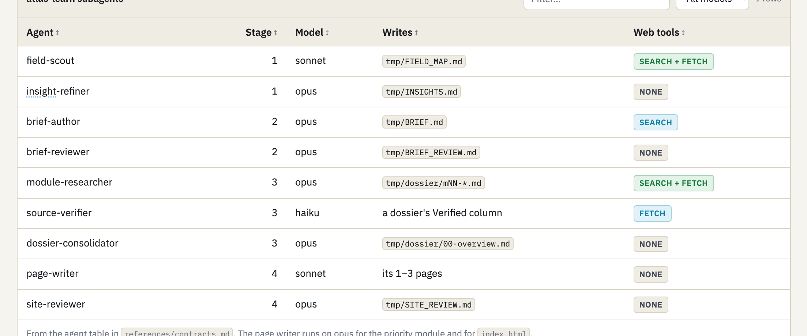
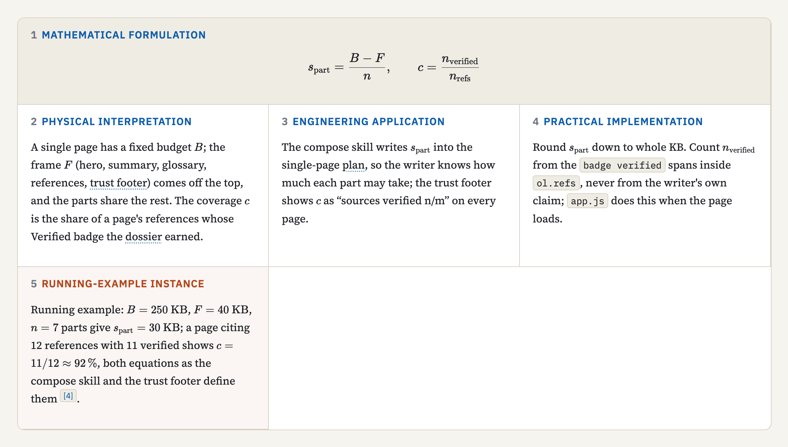
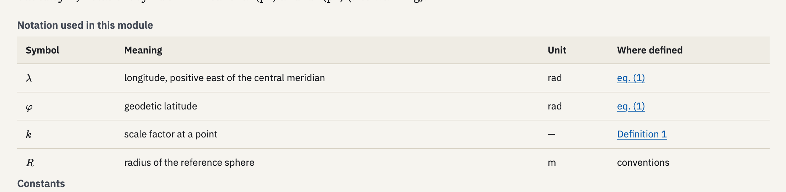
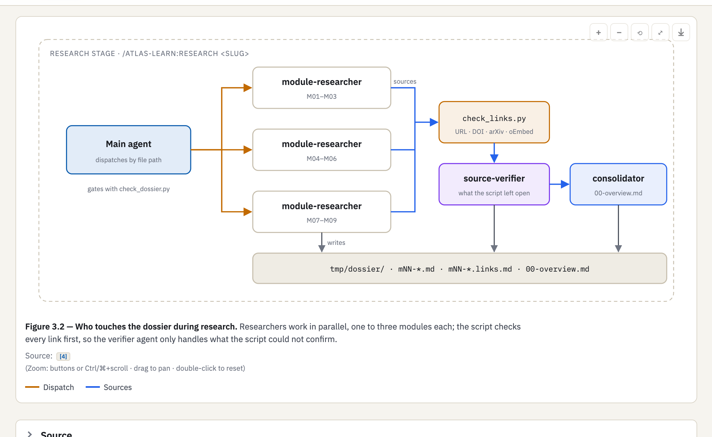
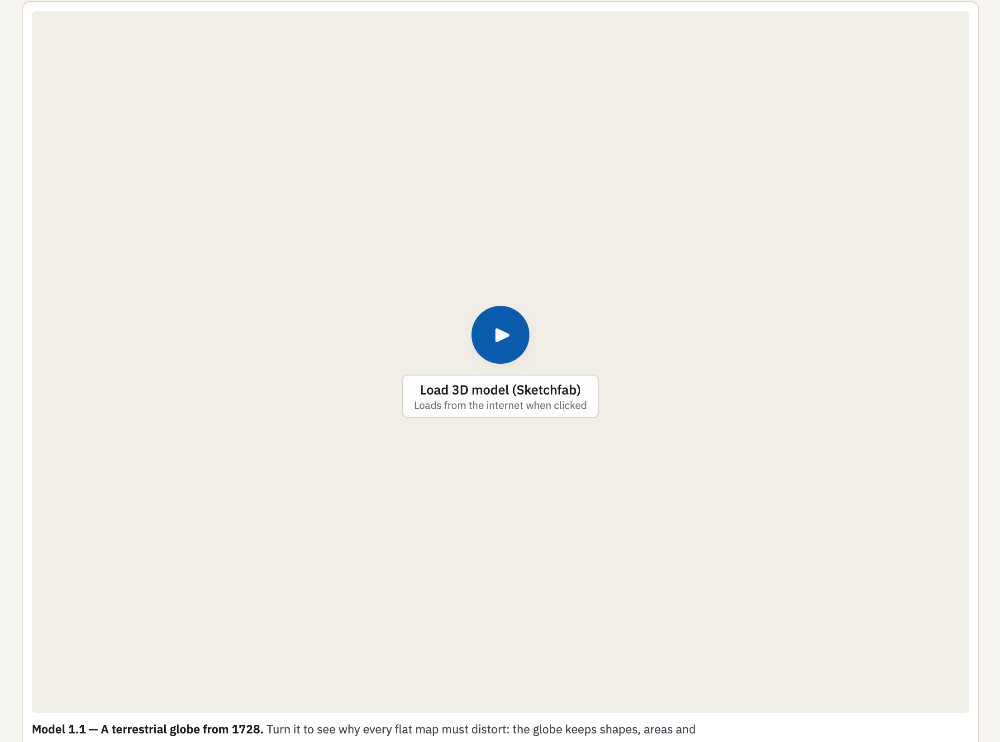
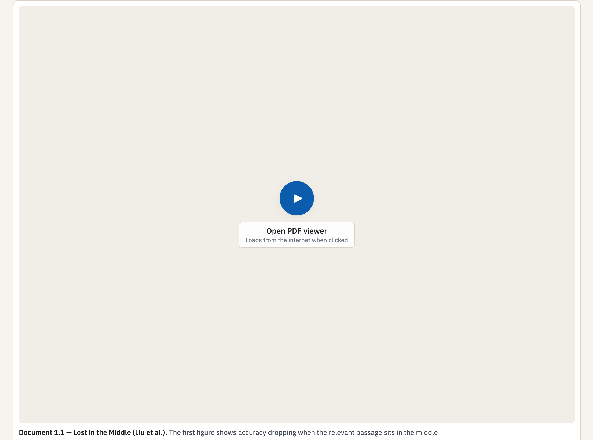
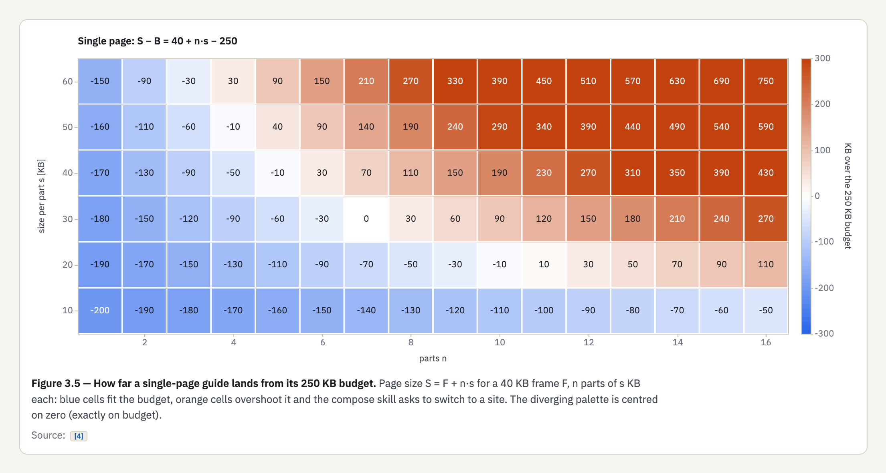
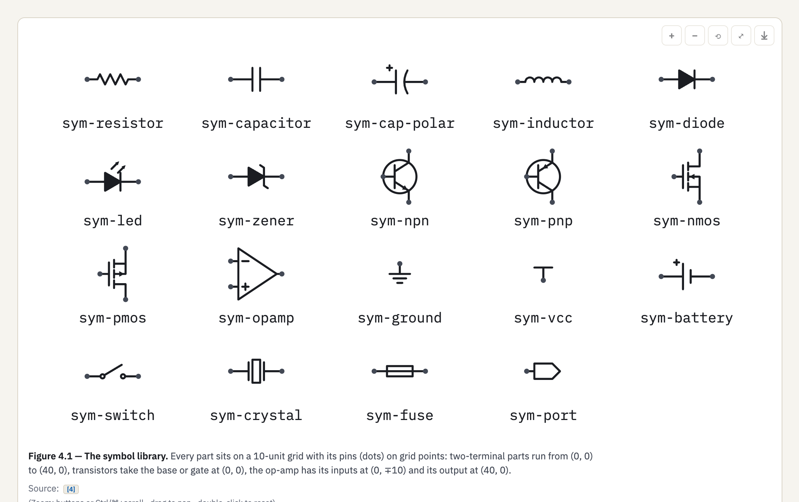
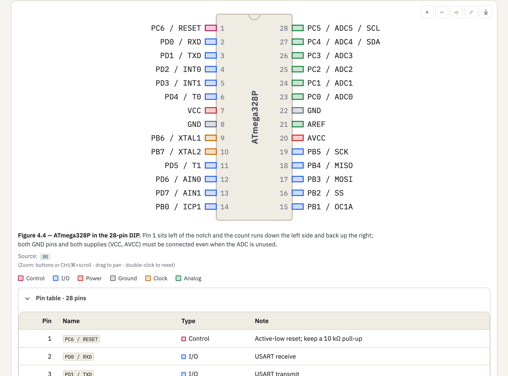
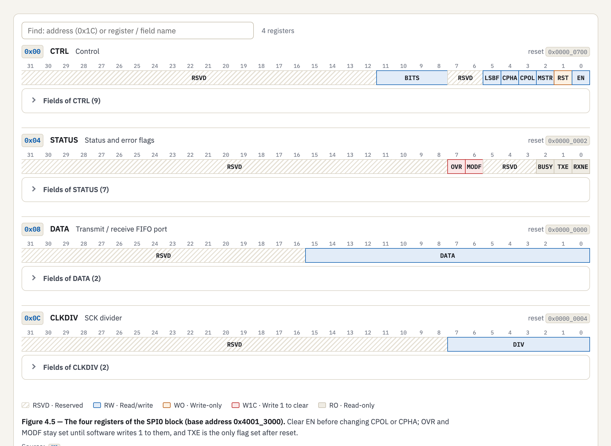

# Supported features

Every atlas-learn handbook is assembled from a fixed catalog of components (see `plugins/atlas-learn/skills/compose/components/`). Each component ships with a rendered example in the plugin's component style guide (`plugins/atlas-learn/skills/compose/template/styleguide.html`); the screenshots below are captured from it.

Headline features - the evidence-backed handbook, the topics dictionary, interactive diagrams, quizzes, plots and the code runner - are shown in the main [README](../README.md). This page documents the rest of the catalog.

## Core

Tables for anything the reader compares row by row:

## Math

Numbered equation blocks with a worked five-step derivation:

A notation page collected from every symbol the site uses:

## Diagrams

Inline SVG diagrams with zoom, pan and SVG/PNG download:

## Media

Interactive 3D models embedded from a file:

Embedded PDFs with in-page navigation:

## Demos

Calculators, simulations and computed plots that re-run in the page. The uncertainty demo is shown in the [README](../README.md#a-look-inside); `demo-calculator`, `demo-plot` and `demo-units` follow the same pattern.

## Plots

Heatmaps, log axes, error bars, function plotters and vector fields:

## Circuit

A symbol library covering resistors, capacitors, diodes, transistors, op-amps, supplies, switches and more:

Pinouts drawn from package data:

Register maps with field-level detail:

The schematic generator is shown in the [README](../README.md#a-look-inside).

## Protocol

Timing, bit-field/packet, sequence and state-machine diagrams written as data. The sequence diagram is shown in the [README](../README.md#a-look-inside).

## Assessment

Knowledge checkpoints, Bloom-tagged exercises, predict-then-reveal questions, checklists and lab sheets - the checkpoint view is shown in the [README](../README.md).

## Study

Flashcards generated from the glossary (Leitner boxes, CSV/Anki export) plus per-reader notes, highlights and bookmarks - flashcards are shown in the [README](../README.md#a-look-inside).

## Runner

In-browser code runners: a sandboxed JavaScript runner and a Python runner, with output captured verbatim - shown in the [README](../README.md#a-look-inside).

## Trust

Every page ends with a provenance footer: sources verified n/m, review date, open-gap count, and a claim-to-evidence table. Visible on every page shot in the [README](../README.md).
